# Laboratório de Programação em C (MAI) - Лабораторная работа

Este repositório contém a resolução das 10 tarefas do laboratório de programação em C (padrão C99). Todos os projetos foram desenvolvidos respeitando as regras globais: sem variáveis globais (глобальные переменные), sem `goto`, com alocação dinâmica de memória (динамическая память), validação de dados (валидация) e retorno de status por `enum`.

Abaixo segue o resumo do que cada tarefa implementa, acompanhado dos textos explicativos e imagens de demonstração.

---

### Task 01: Manipulação de Strings com Flags (Строки и флаги)
- **Descrição:** Processamento de strings passadas via argumentos de linha de comando (аргументы командной строки) usando flags (`-l`, `-r`, `-u`, `-n`, `-c`).
- **Destaque:** Implementação própria de funções de string (sem o uso da biblioteca `<string.h>`).
- **Conceitos:** Alocação dinâmica (выделение памяти), inversão de string (переворот строки), concatenação pseudoaleatória (псевдослучайная конкатенация).

**Testes realizados:**
*   **Flag `-l` (Comprimento):** O comando `-l "OlaMundo"` mede o comprimento da palavra entre aspas. O resultado esperado é 8.
    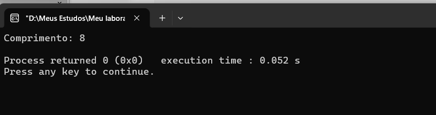

*   **Flag `-r` (Inverter):** O comando `-r "Abacaxi"` inverte os caracteres da palavra. O resultado impresso é `ixacabA`.
    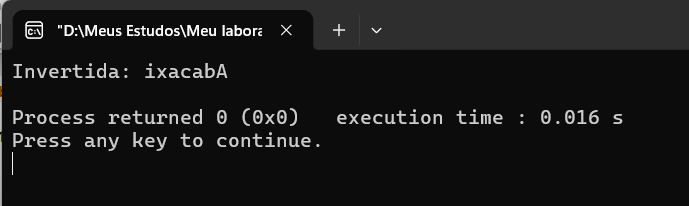

*   **Flag `-u` (Maiúsculas em Ímpares):** O comando `-u "abcdef"` transforma as letras de índices ímpares em maiúsculas. O resultado é `aBcDeF`.
    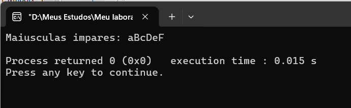

*   **Flag `-n` (Reordenar):** O comando `-n "a1b2!c3"` reorganiza os caracteres: primeiro dígitos, depois letras, depois os demais. O resultado é `123abc!`.
    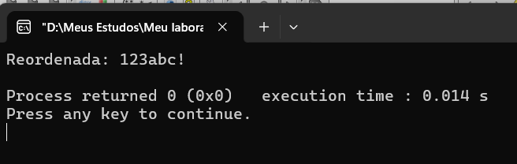

*   **Flag `-c` (Concatenação Pseudoaleatória):** O comando `-c 42 "Ignorada" "str1" "str2" "str3"` descarta a primeira string e embaralha as demais usando o seed 42. O resultado neste teste foi `str3str1str2`.
    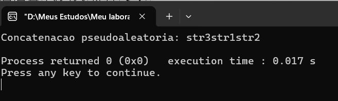

---

### Task 02: Ordenação de Funcionários (Сортировка сотрудников)
- **Descrição:** Leitura de um arquivo (файл) contendo dados de funcionários (id, nome, sobrenome, salário).
- **Destaque:** Ordenação obrigatória usando a função padrão `qsort` (стандартная функция qsort).
- **Conceitos:** Structs, I/O de arquivos, ordenação crescente/decrescente (возрастание/убывание), múltiplos critérios de desempate.

**Teste realizado:**
O programa é executado passando o arquivo de entrada, a flag de ordenação (neste caso `-a` para crescente) e o nome do arquivo de saída.
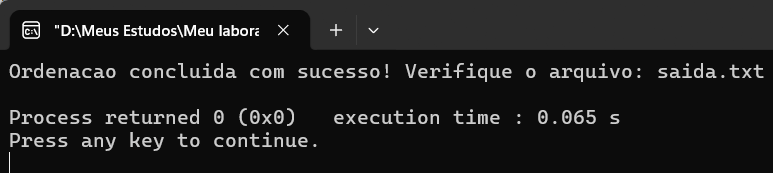

O arquivo `saida.txt` gerado contém os dados ordenados por salário, depois sobrenome, depois nome e, por fim, ID:
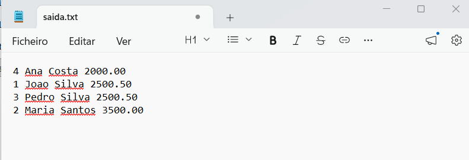

---

### Task 03: Busca de Substrings em Arquivos (Поиск подстрок)
- **Descrição:** Função variádica (функция с переменным числом аргументов) que busca uma substring em múltiplos arquivos.
- **Destaque:** Proibido o uso de `strstr` e `strncmp`. A busca foi implementada caractere por caractere.
- **Conceitos:** `va_list`, leitura de arquivos, busca manual (ручной поиск).

**Teste realizado:**
O programa buscou a substring `"Roma"` nos arquivos `teste1.txt` (1 ocorrência) e `teste2.txt` (2 ocorrências).
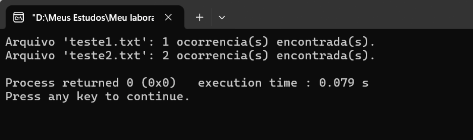

---

### Task 04: Seleção de Arquivos para Backup (Задача о рюкзаке)
- **Descrição:** Escolha de arquivos para backup respeitando uma capacidade máxima (вместимость накопителя).
- **Destaque:** Resolução do clássico Problema da Mochila 0/1 (задача о рюкзаке) usando Programação Dinâmica (динамическое программирование).
- **Conceitos:** Matrizes dinâmicas, otimização de importância (важность), backtracking.

**Teste realizado:**
Entrada de 4 arquivos com capacidade 10. O algoritmo selecionou os arquivos `foto.jpg` e `musica.mp3`, totalizando tamanho 9 e importância 22.
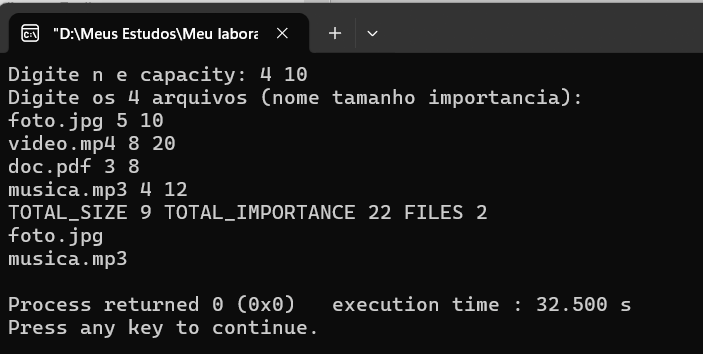

---

### Task 05: `overfprintf` e `oversprintf` (Свои printf)
- **Descrição:** Implementação de funções de escrita formatada similares a `fprintf` e `sprintf`.
- **Destaque:** Novos formatos: `%Ro` (algarismos romanos), `%Zr` (Zeckendorf/Fibonacci), `%Cv`/`%CV` (bases 2-36), `%to`/`%TO` (conversão para base 10) e `%mi`/`%mu`/`%md` (dump de memória em binário).
- **Conceitos:** Argumentos variádicos, manipulação de bits (побитовые операции), conversão de bases (системы счисления).

**Teste realizado:**
Demonstração da impressão de inteiro, string, romano (MCMXCIV), base 16 (ff e FF), conversão (255), binário (`%mi`), Zeckendorf e stream.
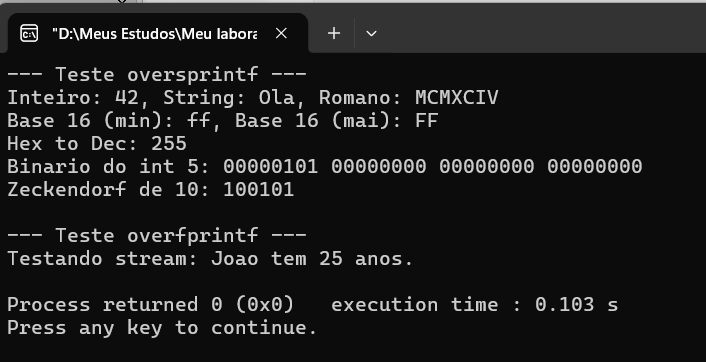

---

### Task 06: `overfscanf` e `overscanf` (Свои scanf)
- **Descrição:** Implementação de funções de leitura formatada similares a `fscanf` e `sscanf`.
- **Destaque:** Leitura dos formatos customizados (`%Ro`, `%Zr`, `%Cv`, `%CV`).
- **Conceitos:** Parsing de strings, conversão de romanos e Fibonacci de volta para inteiros decimais.

**Teste realizado:**
Leitura de string romana (1994), Zeckendorf (10) e base 16 (255) de volta para variáveis inteiras.
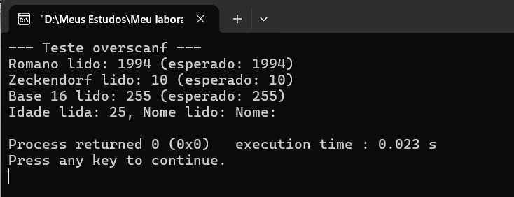

---

### Task 07: Normas de Vetores (Нормы векторов)
- **Descrição:** Função variádica que encontra o vetor de maior norma (самый длинный вектор).
- **Destaque:** Uso de ponteiros para função (указатели на функции) para passar diferentes cálculos de norma: Norma do Infinito, Norma P e Norma A.
- **Conceitos:** Structs, matemática de matrizes, comparação de floats com epsilon (сравнение с эпсилон).

**Teste realizado:**
Dados 3 vetores 2D, a função encontrou o maior para cada uma das 3 normas passadas (Infinito, P e A).
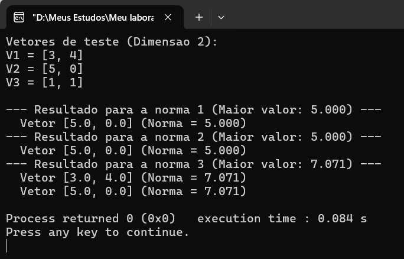

---

### Task 08: Soma de Números Gigantes (Сложение в столбик)
- **Descrição:** Função variádica que soma números inteiros passados como strings em qualquer base de 2 a 36.
- **Destaque:** Implementação da soma "em coluna" (сложение в столбик), como aprendido na escola, para evitar o estouro de tipos numéricos.
- **Conceitos:** Big Numbers, carry (перенос разряда), manipulação de strings numéricas.

**Teste realizado:**
Somas em base 10, base 16 (FF + 1 = 100), base 2 e soma de um número gigante (20 dígitos) com +1.
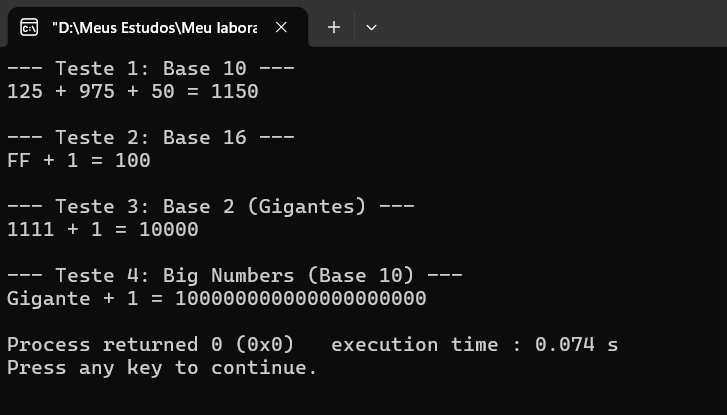

---

### Task 09: Frações com Representação Finita (Конечные дроби)
- **Descrição:** Função variádica que verifica se uma fração decimal tem representação finita em outra base.
- **Destaque:** Multiplicação sucessiva pela base para verificar se a fração "termina".
- **Conceitos:** Matemática de frações (дроби), loops com tolerância (epsilon).

**Teste realizado:**
Verificação de várias frações (0.5, 0.25, 0.1, 0.3) nas bases 2, 10 e 16.
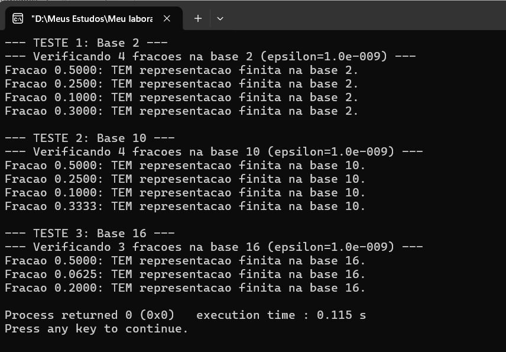

---

### Task 10: Mudança de Base de Polinômios (Переразложение многочлена)
- **Descrição:** Função variádica que transforma um polinômio `f(x)` em potências de `(x - a)`.
- **Destaque:** Uso do Binômio de Newton (Бином Ньютона) para calcular os novos coeficientes.
- **Conceitos:** Arrays dinâmicos, coeficientes binomiais, precisão de ponto flutuante (точность).

**Teste realizado:**
Transformação do polinômio `f(x) = 1.0*x^2 + 3.0*x + 2.0` para a base `(x - 2.0)`, resultando em `(x-2)^2 + 7.00(x-2) + 12.00`.
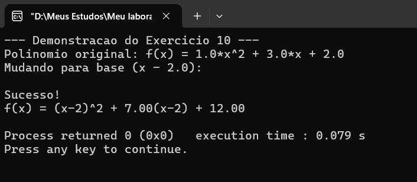

---

## Como Compilar e Executar (Как запустить)
1. Abra a pasta da tarefa desejada no Code::Blocks (abra o arquivo `.cbp`).
2. Certifique-se de que o compilador está configurado para o padrão **C99**.
3. Para tarefas que exigem argumentos (Task 01, 02, 03), vá em `Project -> Set program's arguments...` e insira os parâmetros necessários.
4. Aperte **F9** para compilar e rodar.

*Nota: As pastas de compilação (`bin`, `obj`) e arquivos executáveis foram ignorados via `.gitignore`.*