# Лабораторная работа 03

Este repositório contém a resolução das 10 tarefas do laboratório de programação em C (padrão C99). Todos os projetos foram desenvolvidos respeitando as regras globais do laboratório: 
* Sem variáveis globais (глобальные переменные).
* Sem uso do operador `goto`.
* Alocação dinâmica de memória (динамическая память) com liberação correta (`free`).
* Validação de dados e tratamento de erros (валидация) via `enum` (StatusCode).
* Separação entre lógica de negócios e I/O (Input/Output).

Abaixo segue a explicação detalhada de cada tarefa, como os problemas foram resolvidos e como compilá-las.

---

## Task 01: Conversão de Base com Operações Bit a Bit (Перевод в систему счисления 2^r)

**O que o exercício pedia:**
Converter um número inteiro decimal para uma base \(2^r\) (onde \(r = 1, 2, 3, 4, 5\)). A grande restrição era que **não era permitido usar operadores aritméticos padrão** (`+`, `-`, `*`, `/`, `%`). Apenas operações bit a bit (bitwise) e acesso à memória eram permitidos.

**Como foi resolvido (Pontos Essenciais):**
*   **Substituição da Divisão (`/`):** Para dividir o número pela base \(2^r\), usamos o operador de deslocamento à direita (`>> r`). Exemplo: `num >> 3` é o mesmo que dividir por 8.
*   **Substituição do Módulo (`%`):** Para descobrir o resto da divisão (o dígito atual), criamos uma máscara de bits: `mascara = (1 << r) - 1`. O dígito é obtido com `num & mascara`.
*   **Conversão de Caractere:** O valor do dígito (0-9 ou 10-31) é convertido para o caractere correspondente ('0'-'9' ou 'A'-'V') e armazenado em um buffer de trás para frente, que é invertido no final.
*   **Alocação:** A string resultante é alocada dinamicamente na memória.

**Testes e Demonstração:**
O número decimal `255` foi convertido com sucesso para todas as bases de \(r=1\) até \(r=5\).
*   **Base 2 (Binário):** `11111111`
*   **Base 4 (Quaternário):** `3333`
*   **Base 8 (Octal):** `377`
*   **Base 16 (Hexadecimal):** `FF`
*   **Base 32:** `7V`

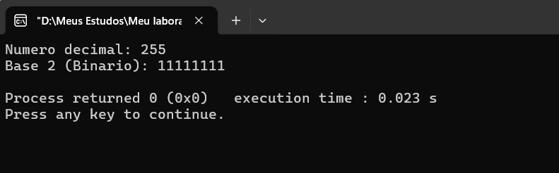
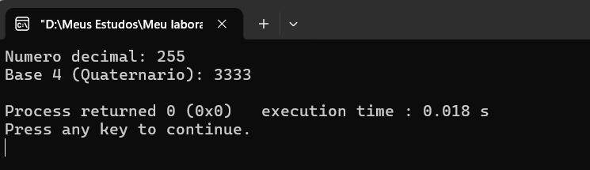
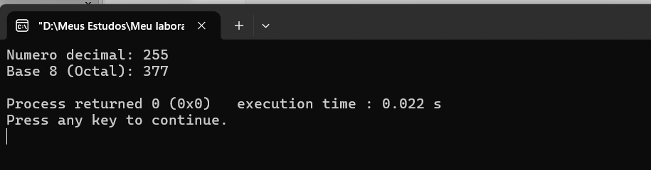
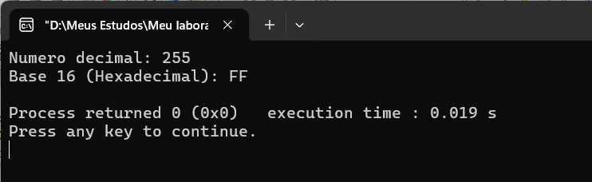
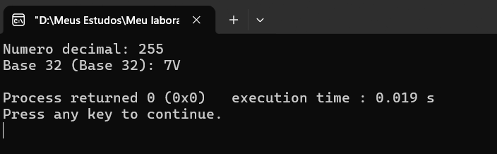

**Como compilar e executar:**
1. Abra o projeto no Code::Blocks (arquivo `.cbp`).
2. Vá em `Project -> Set program's arguments...`.
3. Digite o número e o valor de `r`. Exemplo: `255 3` (para converter 255 para octal).
4. Aperte **F9** para compilar e executar.

---

## Task 02: Agenda de Conferências (Максимальное количество докладов)

**O que o exercício pedia:**
Determinar o número máximo de palestras que podem ser alocadas em \(N\) salas disponíveis, sabendo que palestras na mesma sala não podem se sobrepor no tempo. Os dados (ID, hora de início, hora de fim) são lidos de um arquivo.

**Como foi resolvido (Pontos Essenciais):**
*   **Parsing de Tempo:** As strings de horário (`HH:MM`) são convertidas para minutos totais a partir da meia-noite (ex: `14:30` vira 870 minutos).
*   **Algoritmo Guloso (Greedy):** A função `qsort` ordena todas as palestras pelo **horário de término** (do mais cedo para o mais tarde).
*   **Alocação:** Um array dinâmico (`room_free_time`) armazena o horário em que cada sala fica livre. O algoritmo tenta encaixar cada palestra na primeira sala que estiver livre (`room_free_time[r] <= start_mins`).

**Testes e Demonstração:**
O programa leu 5 palestras de um arquivo. Utilizando 2 salas, o algoritmo conseguiu agendar as 5 palestras, provando que a alocação foi ótima e sem conflitos.

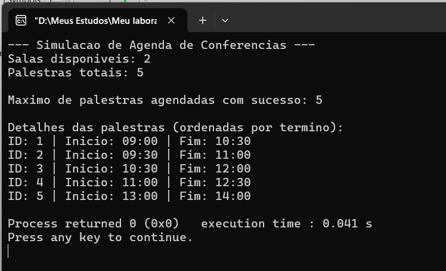

**Como compilar e executar:**
1. Crie um arquivo `palestras.txt` com os dados.
2. Vá em `Project -> Set program's arguments...`.
3. Digite: `2 palestras.txt` (2 salas e o nome do arquivo).
4. Aperte **F9**.

---

## Task 03: Compressão de Huffman (Код Хаффмана)

**O que o exercício pedia:**
Ler um arquivo em modo binário, calcular a frequência dos 256 valores possíveis de bytes, construir uma Árvore de Huffman usando uma Min-Heap implementada do zero, gerar os códigos e calcular a economia de espaço.

**Como foi resolvido (Pontos Essenciais):**
*   **Min-Heap:** Foi criada uma estrutura de fila de prioridade manual com as funções `heapify_up` e `heapify_down`.
*   **Construção da Árvore:** Os dois nós com menores frequências são extraídos, somados em um nó pai, e o pai é reinserido. Isso se repete até sobrar a raiz.
*   **Geração de Códigos:** Uma travessia DFS (`generate_codes_rec`) percorre a árvore. Se for para a esquerda, adiciona '0'; para a direita, '1'. Ao chegar na folha, o código é salvo.
*   **Cálculos:** O tamanho total é calculado como `frequência * tamanho_do_codigo` para cada byte.

**Testes e Demonstração:**
O arquivo original de teste tinha 73 bytes. Após a codificação de Huffman, o tamanho caiu para 36 bytes, gerando uma economia de **50.68%**. A imagem mostra a tabela de códigos gerada.

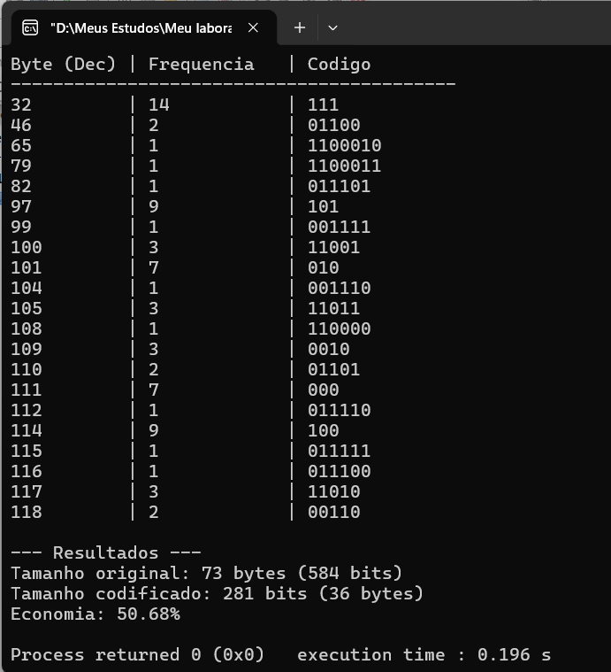

**Como compilar e executar:**
1. Crie um arquivo `texto.txt` com algum conteúdo.
2. Vá em `Project -> Set program's arguments...`.
3. Digite: `texto.txt`.
4. Aperte **F9**.

---

## Task 04: Sistema de Correios (Почтовые отправления)

**O que o exercício pedia:**
Criar um sistema de gestão de encomendas. Era obrigatório criar uma estrutura `String` própria (sem usar `<string.h>`), contendo structs aninhadas (`Address` dentro de `Mail` dentro de `Post`), com alocação dinâmica e um menu interativo.

**Como foi resolvido (Pontos Essenciais):**
*   **Estrutura String:** Criamos funções manuais para calcular tamanho (`my_strlen`), copiar (`my_strcpy`), comparar (`my_strcmp`) e concatenar (`string_concat`).
*   **Alocação Dinâmica:** O array de `Mail` dentro de `Post` cresce dinamicamente com `realloc` sempre que o limite é atingido.
*   **Ordenação:** A função `qsort` foi usada com um comparador que ordena primeiro pelo CEP (`zip_code`) e depois pelo ID da encomenda.
*   **Menu:** Um loop `while` permite ao usuário adicionar, remover, buscar e listar encomendas.

**Testes e Demonstração:**
O menu permitiu listar as encomendas ordenadas por CEP (Rio antes de BH) e buscar uma encomenda específica pelo ID de rastreio.

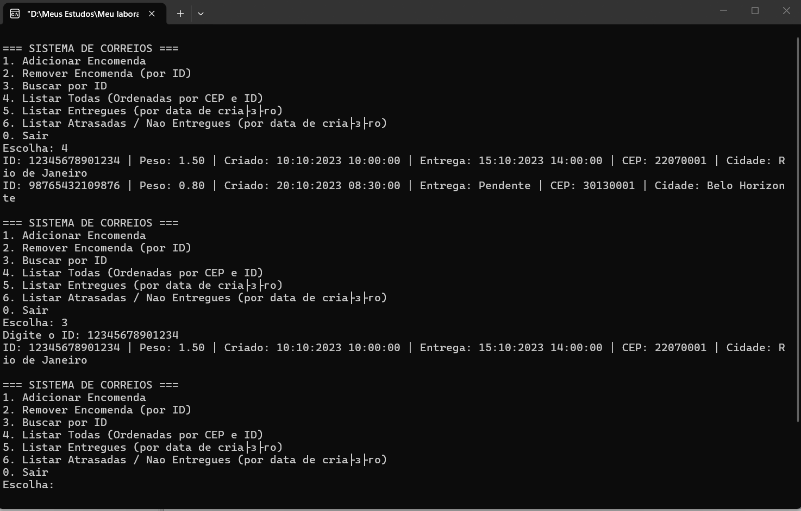

**Como compilar e executar:**
1. Abra o projeto no Code::Blocks.
2. Não precisa de argumentos de linha de comando.
3. Aperte **F9** e use o menu interativo no console.

---

## Task 05: Sistema de Alunos (Система студентов)

**O que o exercício pedia:**
Ler um arquivo com dados de alunos (ID, nome, sobrenome, grupo e 5 notas), armazenar em um array dinâmico, permitir buscas e ordenações usando `qsort`, e gerar um arquivo de trace com informações específicas (alunos acima da média e dados de um aluno buscado por ID).

**Como foi resolvido (Pontos Essenciais):**
*   **Leitura Dinâmica:** O array de `Student` cresce conforme a leitura do arquivo.
*   **Funções de Comparação:** Criamos funções específicas para o `qsort` (por ID, nome, sobrenome, grupo).
*   **Média Geral:** O programa calcula a média de cada aluno, depois a média de toda a turma. 
*   **Arquivo de Trace:** O arquivo `trace.txt` é aberto em modo `"a"` (append) para registrar as consultas feitas no menu.

**Testes e Demonstração:**
O programa carregou 5 alunos. A opção 2 salvou no `trace.txt` os alunos com média acima da média geral. A opção 3 ordenou os alunos por ID.

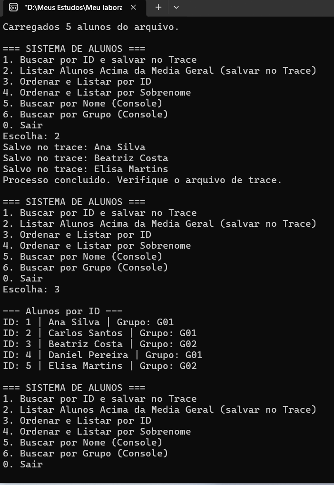
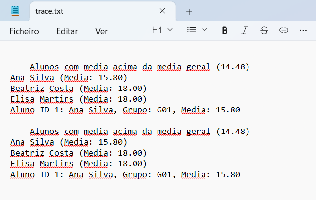

**Como compilar e executar:**
1. Crie um arquivo `alunos.txt` com os dados.
2. Vá em `Project -> Set program's arguments...`.
3. Digite: `alunos.txt trace.txt`.
4. Aperte **F9** e use o menu.

---

## Task 06: Sistema de Transporte (Система учета транспорта)

**O que o exercício pedia:**
Ler múltiplos arquivos de paragens de ônibus e construir uma estrutura de **Lista Ligada de Listas Ligadas**. A lista principal contém os veículos, e cada veículo tem uma sub-lista de paragens ordenadas cronologicamente.

**Como foi resolvido (Pontos Essenciais):**
*   **Estrutura:** Criamos `VehicleNode` (lista principal) e `StopNode` (sub-lista).
*   **Parsing:** A função `process_file` lê o arquivo linha por linha, separando o ID do veículo, horários e tipo de paragem.
*   **Inserção Ordenada:** A função `insert_stop_sorted` insere a paragem na sub-lista comparando as strings de data/hora para manter a ordem cronológica.
*   **Busca:** O menu permite buscar um veículo pelo ID e imprimir toda a sua rota.

**Testes e Demonstração:**
O programa leu 3 arquivos de paragens e montou a rota do `BUS01` em ordem cronológica correta (Paragem A -> B -> C).

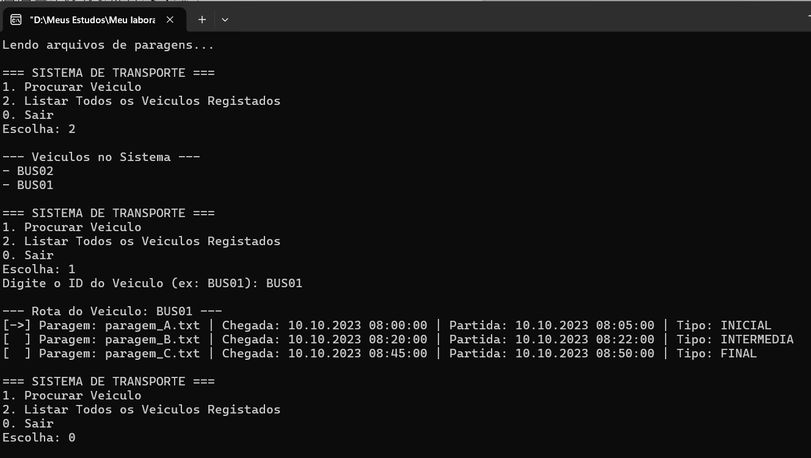

**Como compilar e executar:**
1. Crie os arquivos `paragem_A.txt`, `paragem_B.txt`, `paragem_C.txt`.
2. Vá em `Project -> Set program's arguments...`.
3. Digite: `paragem_A.txt paragem_B.txt paragem_C.txt`.
4. Aperte **F9**.

---

## Task 07: Sistema de Habitantes com Undo (Жители и Undo)

**O que o exercício pedia:**
Ler dados de habitantes (nome, data de nascimento, sexo, renda) para uma lista ligada ordenada por idade. Implementar busca, modificação, remoção, adição e uma função de **Undo** (desfazer) para reverter as últimas modificações.

**Como foi resolvido (Pontos Essenciais):**
*   **Lista Ordenada:** A função `insert_sorted` insere os habitantes comparando o ano, mês e dia de nascimento, mantendo os mais velhos primeiro.
*   **Pilha de Undo:** Criamos uma pilha (`UndoNode`) que armazena o tipo de ação (`ACTION_ADD`, `ACTION_REMOVE`, `ACTION_MODIFY`) e os dados do habitante antes da modificação.
*   **Reverter:** A opção 5 desempilha a última ação e executa a operação inversa (se adicionou, remove; se removeu, adiciona de volta).

**Testes e Demonstração:**
O programa carregou os habitantes ordenados por idade. O menu interativo funcionou perfeitamente para listar os dados.

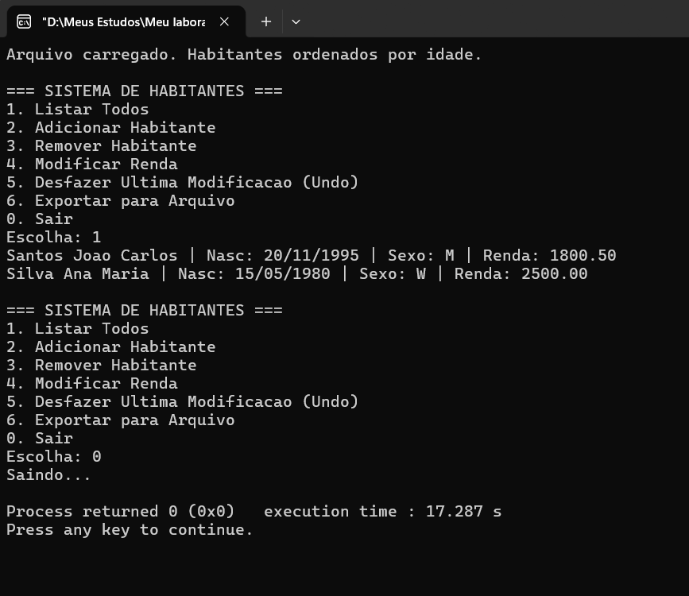

**Como compilar e executar:**
1. Crie o arquivo `habitantes.txt`.
2. Vá em `Project -> Set program's arguments...`.
3. Digite: `habitantes.txt`.
4. Aperte **F9** e use o menu.

---

## Task 08: Manipulação de Polinômios (Многочлены)

**O que o exercício pedia:**
Processar um arquivo de texto com instruções matemáticas (`Add`, `Sub`, `Mult`, `Div`, `Mod`, `Eval`, `Diff`, `Cmps`) para realizar operações com polinômios de coeficientes inteiros. Manter um acumulador para instruções de um único parâmetro.

**Como foi resolvido (Pontos Essenciais):**
*   **Representação:** O polinômio é um array dinâmico de inteiros, onde o índice é o expoente.
*   **Parsing:** A função `poly_parse` lê strings como `2x^2-x+2` e preenche o array de coeficientes.
*   **Acumulador:** Se a instrução tiver apenas 1 argumento, o primeiro termo é o valor do acumulador.
*   **Operações:** Cada comando (`Add`, `Mult`, etc.) tem sua própria função lógica.

**Testes e Demonstração:**
O programa executou as instruções do arquivo, atualizando o acumulador e imprimindo os resultados parciais.

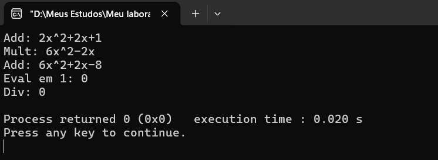

**Como compilar e executar:**
1. Crie o arquivo `instrucoes.txt` com as instruções matemáticas.
2. Vá em `Project -> Set program's arguments...`.
3. Digite: `instrucoes.txt`.
4. Aperte **F9**.

---

## Task 09: Estatísticas de Palavras com Árvore Binária (Дерево поиска)

**O que o exercício pedia:**
Processar um arquivo de texto, contar a frequência de cada palavra e armazenar em uma **Árvore Binária de Busca (BST)**. O menu deve permitir buscar palavras, mostrar as N mais frequentes e as palavras mais longa/curta.

**Como foi resolvido (Pontos Essenciais):**
*   **BST:** A inserção (`tree_insert`) compara a palavra com a raiz. Palavras iguais incrementam o contador; menores vão para a esquerda, maiores para a direita.
*   **Top N:** Uma função `collect_stats` copia todos os nós para um array e usa `qsort` para ordenar pela frequência decrescente.
*   **Extremos:** Uma travessia recursiva (`tree_find_extremes`) compara o comprimento de cada palavra para achar a mais longa e a mais curta.
*   **Persistência:** As funções `tree_save_binary` e `tree_load_binary` salvam e carregam a árvore em arquivo binário.

**Testes e Demonstração:**
O programa processou o texto e mostrou as 3 palavras mais frequentes (`de`, `Roma`, `a`). A árvore foi montada corretamente.

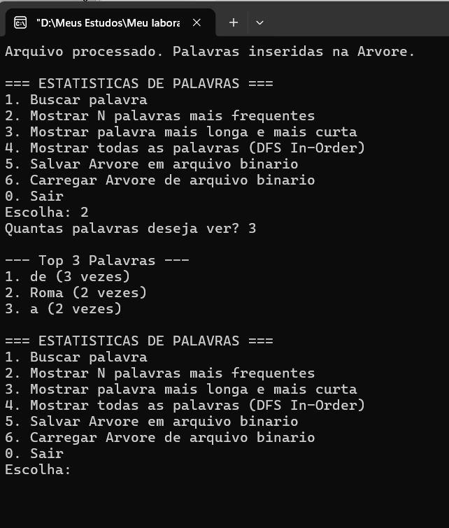

**Como compilar e executar:**
1. Crie o arquivo `texto.txt`.
2. Vá em `Project -> Set program's arguments...`.
3. Digite: `texto.txt " .,;"` (os separadores entre aspas).
4. Aperte **F9** e use o menu.

---

## Task 10: Árvore de Expressões com Parênteses (Дерево скобочного выражения)

**O que o exercício pedia:**
Ler um arquivo com expressões hierárquicas usando parênteses (ex: `A (B, C)`) e construir uma árvore N-ária. Salvar a árvore em um arquivo de texto em formato de desenho.

**Como foi resolvido (Pontos Essenciais):**
*   **Parsing Recursivo:** A função `parse_expression` lê o caractere. Se o próximo for `(`, ela entra em um loop, chamando a si mesma para ler os filhos, separando por vírgulas e parando no `)`.
*   **Árvore N-ária:** Cada nó tem um array dinâmico de ponteiros para os filhos, permitindo nós com 2, 3 ou mais filhos (como o nó `E` do exemplo).
*   **Desenho:** A função `print_tree_to_file` percorre a árvore recursivamente e desenha as ramificações (`├──` e `└──`) com indentação.

**Testes e Demonstração:**
O programa leu a expressão do arquivo e gerou o arquivo `saida.txt` com sucesso.

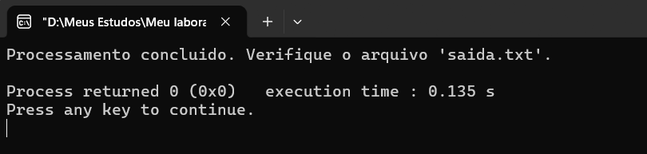
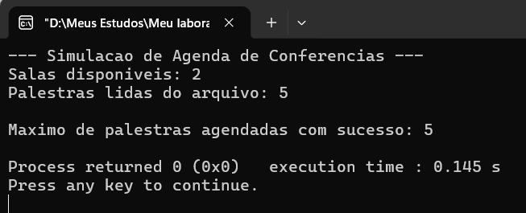

**Como compilar e executar:**
1. Crie o arquivo `expressoes.txt`.
2. Vá em `Project -> Set program's arguments...`.
3. Digite: `expressoes.txt saida.txt`.
4. Aperte **F9**.

---

## Como Compilar e Executar (Как запустить)

1.  Abra a pasta da tarefa desejada no **Code::Blocks**.
2.  Certifique-se de que o compilador está configurado para o padrão **C99**.
3.  Para tarefas que exigem argumentos (Task 01, 02, 03, 05, 08, 09, 10), vá em `Project -> Set program's arguments...` e insira os parâmetros necessários (como mostrado acima).
4.  Aperte **F9** para compilar e rodar.

*Nota: As pastas de compilação (`bin`, `obj`) e arquivos executáveis foram ignorados via `.gitignore`.*